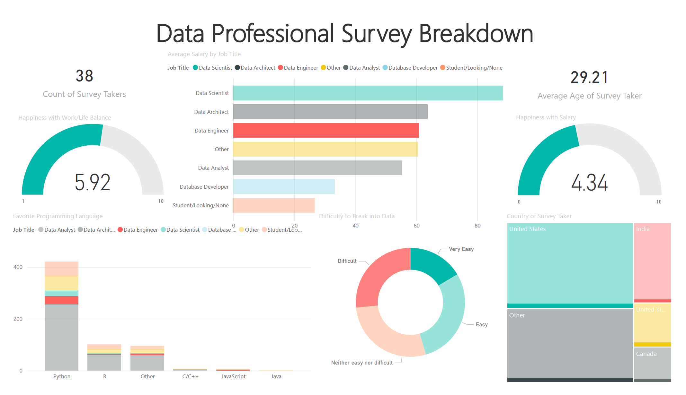

# data-professional-survey-powerbi
An interactive business intelligence report analyzing global survey responses from data professionals—examining compensation benchmarks across roles, programming language preferences, career entry barriers, and workplace satisfaction.

## Data Professional Survey Breakdown — Power BI Dashboard

An interactive business intelligence report analyzing global survey responses from data professionals—examining compensation benchmarks across roles, programming language preferences, career entry barriers, and workplace satisfaction.

*(You can also view the exported report directly in this repository: [`Visualization in PDF format.pdf`](Visualization%20in%20PDF%20format.pdf)*

---

## Business Objective
The goal of this project is to transform raw, unstructured survey responses into an intuitive executive dashboard that helps aspiring analysts, hiring managers, and career switchers benchmark compensation expectations, technical skill demand, and work-life satisfaction across the data industry.

---

## Key Analytical Insights

### 1. Compensation & Role Hierarchy
* **Top-Earning Roles:** **Data Scientists** lead the salary distribution, followed closely by **Data Architects** and **Data Engineers**, reflecting higher market premiums for advanced modeling and data infrastructure engineering.
* **Entry & Mid-Level Benchmarks:** **Data Analysts** and **Database Developers** occupy the mid-tier compensation band, while respondents in the **Student / Looking / None** category anchor the lower end of the scale.

### 2. Technical Stack & Language Dominance
* **Python as the Industry Standard:** **Python** overwhelmingly dominates as the favorite programming language across nearly every job title (especially among Data Analysts, Data Scientists, and Data Engineers), outpacing **R** and **Other** languages by a wide margin.
* **Niche Adoption:** Languages such as **C/C++**, **JavaScript**, and **Java** represent a minimal share of primary preferences in day-to-day data workflows.

### 3. Career Entry Barriers & Satisfaction Metrics
* **Breaking Into the Industry:** Roughly half of respondents rated breaking into data as **Neither easy nor difficult** or **Difficult**, while a smaller segment found the transition **Easy** or **Very Easy**, highlighting the competitive nature of entry-level data roles.
* **Work-Life Balance vs. Compensation:** Professionals reported a noticeably higher average satisfaction score for **Work/Life Balance (5.92 / 10)** compared to **Salary Satisfaction (4.34 / 10)** across a respondent base with an average age of **29.21 years**.
* **Geographic Distribution:** Survey participation is heavily concentrated in the **United States**, followed by **India**, the **United Kingdom**, and **Canada**.

---

## Data Cleaning & Preparation (Power Query)
To ensure accurate aggregations from raw survey inputs, the following ETL transformations were applied in **Power Query**:
* **Salary Range Normalization:** Parsed open-ended and bracketed salary strings (e.g., `"$60k-$80k"`) by splitting delimiters, cleaning currency symbols, and calculating the midpoint average salary per respondent.
* **Category Consolidation:** Standardized free-text entries in *Job Title*, *Country*, and *Favorite Programming Language* by grouping low-frequency custom responses into a clean `"Other"` category to eliminate visual clutter.
* **Data Type Enforcement:** Converted age, satisfaction ratings, and compensation fields into numeric types (`Decimal` / `Whole Number`) for accurate KPI card calculations.

---

## Tools & Skills Demonstrated
* **Power BI Desktop:** Interactive dashboard layout, KPI cards, treemap, donut chart, stacked column chart, horizontal bar chart, and gauge visuals.
* **Power Query (M):** Data cleansing, column splitting, conditional grouping, and schema standardization.
* **Dataset:** Power BI - Final Project 2022 (Alex The Analyst) - https://github.com/AlexTheAnalyst/Power-BI/blob/main/Power%20BI%20-%20Final%20Project.xlsx
